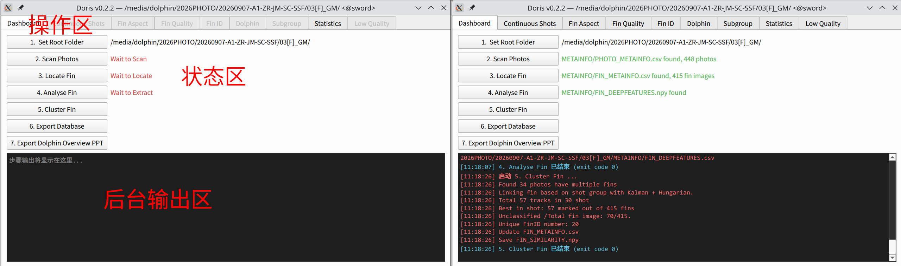
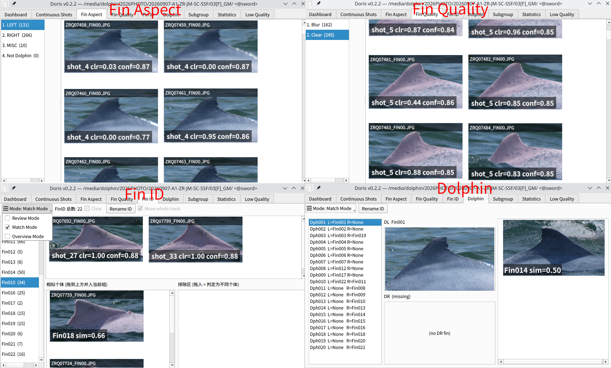
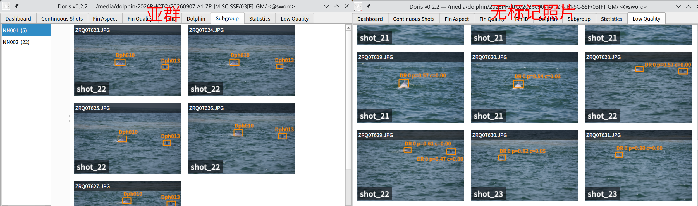

# 使用指南

DORIS(DOlphin ReIdentify Scripts) 是算法辅助的白海豚背鳍群匹配工具。适用聚类开放集合的白海豚图像。
DORIS 内置四个预训练神经网络模型，预处理野外照片，推算背鳍的位置、体位、图像质量、特性向量，并依其
归类相同背鳍和匹配左右背鳍。随后，研究者校验、合并、拆分、标记。

## 算法推算
启动主程序后，依次点击 Dashboard 标签页的按钮1 到 5，得算法推算结果，按钮右侧更新状态。这几步计算密集，
建议配合 GPU 使用。推算结果保存，重新打开 DORIS 后选中根目录，自动复用处理结果。

## 用户校验
主程序的其它标签页用于游览归类结果，拆分、合并、纠正错误的推算结果，以及新增人工标记。

1. "Continuous Shots" 标签页里可游览独立的连拍镜头。顶部有下拉菜单“ShotType”，选择即标记该组镜头
为 "NOTE"/"MISC"/"SEABIRD"，用于标记环境和群信息。顶部还显示该组镜头拍摄的时间，
镜头焦距，相机对焦距离。
2. "Fin Aspect" 标签页按 LEFT/RIGHT/MISC/Not Dolphin 分类背鳍。核查特定分类时，可手动拖动推算有误的背鳍。
3. "Fin Quality" 标签页按 Blur/Clear 分类背鳍。核查特定分类时，可手动拖动推算有误的背鳍。
4. "Fin ID" 标签页按 Fin ID 分类背鳍，含三种模式：Review Mode, Match Mode, Overview Mode。 Match Mode 下视图
分为三个相册，顶部相册为归到当前 Fin ID 的背鳍，底部左相册为存疑的候选背鳍，底部右相册为确定排除的背鳍。拖动
背鳍到对应相册核实归类。排异的背鳍组合不会再出现在该组合的任一 FinID 的存疑候选相册。
5. "Dolphin" 标签页按 Dolphin ID 组合背鳍、分类海豚，含三种模式：Review Mode, Match Mode, Overview Mode。
Match Mode 的中间栏，上下分别显示左背鳍和右背鳍；如果左右背鳍不完整，右栏显示缺失侧的候选背鳍，可选中拖动。
6. "Subgroup" 标签页显示同时出现的海豚亚群。
7. "Low Quality" 标签页显示既没有可识别的海豚，也没有环境和群信息标记的照片。

    
## 数据导出
点击 Dashboard 标签页按钮 6 和 7，原始照片按海豚 ID 和亚群复制到不同文件夹，并生成含最佳的幻灯片。

